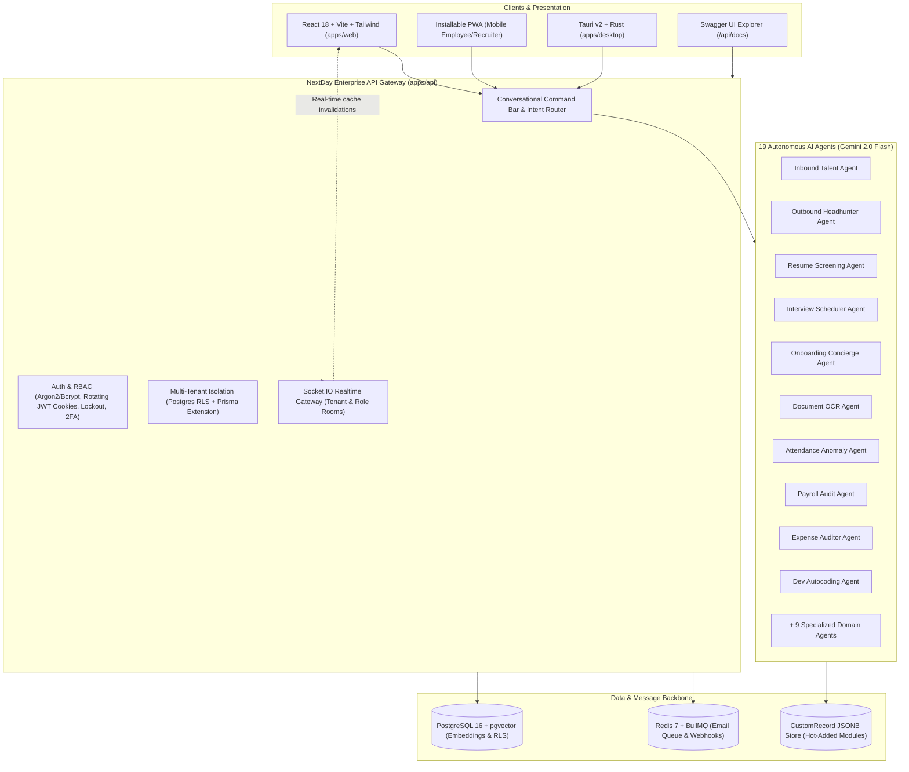

# NextDay – AI-Native Enterprise Recruiting, Onboarding & HR Suite

NextDay is a lightweight, modern Workday alternative engineered from first principles around a conversational **"Zero-UI"** command bar, **19 autonomous AI agents**, and an **Autocoding Dynamic Module Engine**.

---

## 🏗️ Architecture Overview



---

## ⚡ Quickstart Setup (< 5 Commands)

```bash
# 1. Install all dependencies across monorepo workspaces
npm install

# 2. Launch PostgreSQL (with pgvector) and Redis
docker compose up -d

# 3. Apply database migrations and seed full enterprise demo dataset
npm run db:push --workspace=@nextday/api
npm run db:seed --workspace=@nextday/api

# 4. Start both API (port 4000) and Web app (port 5173) in development
npm run dev
```

The Web Application will be live at `http://localhost:5173`.  
The API Gateway & Swagger Docs will be available at `http://localhost:4000/api/docs`.

---

## 🔑 Seeded Demo Credentials

| Role | Email | Password | Primary Interface Focus |
|---|---|---|---|
| **SUPER_ADMIN** | `admin@nextday.work` | `AdminPass123!` | System settings, API keys, Webhooks, RLS |
| **HR_ADMIN** | `hr@nextday.work` | `Password123!` | Executive dashboard, Autocoding, Payroll |
| **RECRUITER** | `recruiter@nextday.work` | `Password123!` | ATS Kanban, Semantic search, Interview scheduling |
| **MANAGER** | `manager@nextday.work` | `Password123!` | Team leaves, Attendance anomaly approvals |
| **EMPLOYEE** | `employee@nextday.work` | `Password123!` | Live Punch clock, PTO balance, Payslips |
| **CANDIDATE** | `candidate@nextday.work` | `Password123!` | Public application tracking, E-Sign |

*(Quick-fill buttons are provided directly on the Login page for instant one-click testing.)*

---

## 🤖 19 Autonomous AI Agents

1. **Inbound Talent Agent** – Parses resumes, extracts technical skills, scores against job descriptions, and proposes interview slots.
2. **Outbound Headhunter Agent** – Performs semantic matching on hiring briefs and drafts tailored outreach emails.
3. **Resume Screening & Ranking Agent** – Evaluates candidate batches with weighted rubrics.
4. **Interview Scheduler Agent** – Resolves calendar slots and generates secure meeting rooms.
5. **Interview Question Generator** – Generates technical and behavioral rubrics tailored to candidate seniority.
6. **Onboarding Concierge Agent** – Interactive chat assistant that auto-completes eligible checklist tasks.
7. **Document Verification & OCR Agent** – Extracts metadata from passports, tax forms, and IDs.
8. **OrgGraph Maintenance Agent** – Verifies reporting structures and cross-functional graph edges.
9. **Attendance Anomaly Resolution Agent** – Detects missing punches and suggests one-tap manager shift approvals.
10. **Schedule Optimization Agent** – Rebalances weekly shift coverage.
11. **Leave Policy Agent** – Verifies PTO balances, blackout windows, and team concurrency.
12. **Payroll Audit Agent** – Nightly cron scanning gross-to-net calculations and flagging deltas > 5%.
13. **Benefits Advisor Agent** – Answers employee inquiries regarding 401(k), HSA/FSA, and vesting.
14. **Expense Auditor Agent** – Extracts line items and auto-approves compliant reimbursements under $100.
15. **Cashflow Forecaster Agent** – Models upcoming payroll disbursements and runway requirements.
16. **Compliance Watchdog Agent** – Tracks document expirations and triggers renewal alerts.
17. **HR Analytics & Insights Agent** – Synthesizes weekly retention and hiring velocity signals.
18. **Email Drafting Agent** – Drafts personalized offer letters, invites, and policy memos.
19. **Dev / Autocoding Agent** – Translates natural language requirements into validated JSON module schemas.

---

## 🛠️ Autocoding Dynamic Module Engine

Admins can type commands like `"Add a vaccination tracking dashboard"` or `"Add equipment & asset registry"`. The **Dev Agent** creates a validated `ModuleSpec`:
- Entity fields with types (`text`, `number`, `date`, `select`, `badge`, `boolean`)
- Table columns configuration
- Dynamic Recharts analytics widgets (`pie`, `bar`, `line`)
- Role-based permissions

Storage is automatically managed in `CustomRecord` (JSONB) with full CRUD APIs and zero code execution (no `eval` / `vm2`). Modules appear hot-added in the sidebar immediately.

---

## 🚀 Render Blueprint Deployment

1. Connect your repository to Render.
2. Select **New** → **Blueprint** and point to `render.yaml`.
3. Configure `DATABASE_URL` and `REDIS_URL` in Render's secure environment settings using the approved external PostgreSQL and Redis endpoints. The blueprint intentionally does not provision duplicate database or Redis services. Production `REDIS_URL` must use TLS (`rediss://`).
4. Configure `GEMINI_API_KEY` if provider-backed AI is approved. Set `JWT_SECRET`, `JWT_REFRESH_SECRET`, and `COOKIE_SECRET` through secure settings; Render generates these in the blueprint. Set `CORS_ORIGIN` to the exact frontend origin and the web `VITE_API_URL` to the API origin. These values are intentionally requested during blueprint setup instead of assuming Render assigned the expected service URLs. Refresh cookies are host-only, HTTP-only, secure in production, and scoped to the auth path.
5. The API startup initializes Prisma schema only when the tenant table is absent and runs demo seeding only when the database contains no tenants. Existing databases are not automatically schema-pushed or seeded at startup.
6. Render provisions the API Web Service and Web Static Site. The API uses `/health`; Swagger is served at `/api/docs`.

---

## 🖥️ Tauri v2 Desktop Build

```bash
cd apps/desktop
npm install
npm run tauri build
```
Provides native OS DPAPI/Keychain token storage and direct CSV report exports to the user's `Downloads` directory.

---

## 📋 5-Minute Walkthrough Demo Script

1. **Sign In**: Navigate to `http://localhost:5173/login` and click the **Super Admin** quick-fill button.
2. **Conversational Command Bar**: Press `Ctrl+K` (or `Cmd+K` on macOS) to open the Zero-UI bar.
   - Type `"Show top 5 backend candidates"` and hit `Enter` → Instantly displays ranked matches and routes to ATS Kanban.
   - Type `"Add a vaccination tracking dashboard"` → Dev Agent generates the schema with confirmation prompt.
3. **Recruiting Pipeline**: Head to **Recruiting & ATS**, click **Semantic Search**, and search for *"Distributed backend engineer with Redis and Kafka experience"*. Watch pgvector rank candidates.
4. **Time & Attendance**: Go to **Time & Attendance**, click **Punch IN** with live browser geolocation. Notice the anomaly resolution card for missing punches with one-tap approval.
5. **Email Templates & AI Draft**: Open **Email Communications**, select the *Official Offer Letter* template with Handlebars variable auto-fill. Click **AI Draft Email** to polish the tone with Gemini.
6. **Autocoding Custom Modules**: Visit **Autocoding Engine**, review the generated *Vaccination Tracker* and *Asset Registry*, add records, and observe live Recharts analytics updates.
